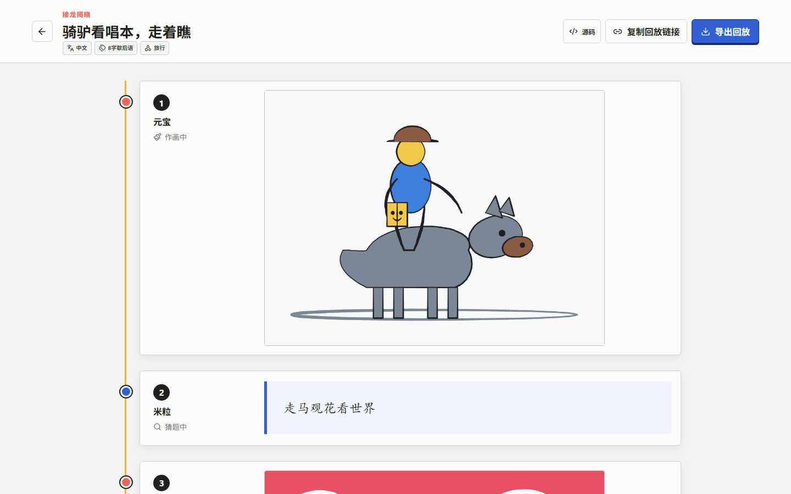
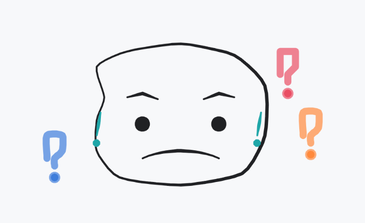

# DrawGuessAI

[简体中文](#简体中文) | [English](#english)

## 精选回放 / Featured Replay

[](https://drawguessai-preview.wujingit.workers.dev/?replay=5FPPFTC3.ySGKoHUPi39iesa0pr2uKA)

[在浏览器中查看完整 8 棒 AI 接龙 · Open the complete eight-turn AI relay](https://drawguessai-preview.wujingit.workers.dev/?replay=5FPPFTC3.ySGKoHUPi39iesa0pr2uKA)

## AI 绘画示例 / AI Drawing Samples

| 消防车 / Fire engine                               | 困惑 / Confusion                                   |
| -------------------------------------------------- | -------------------------------------------------- |
|  |  |

## 简体中文

DrawGuessAI 是一个开放源码的 AI 画猜接龙游戏。人类与受限 AI 画手共享同一套画板规则，可以旁观纯 AI 接龙，也可以和朋友通过邀请房间参与盲接龙。

[在线试玩](https://drawguessai-preview.wujingit.workers.dev) · [GitHub 源码](https://github.com/FirotSilence/DrawGuessAI)

### 本地开发

```bash
pnpm install
pnpm dev
```

Web 界面默认运行于 `http://localhost:5173`，Cloudflare Worker 默认运行于 `http://localhost:8787`。玩家可以在“模型档案”中配置 OpenAI Chat Completions 或 Anthropic Messages 兼容端点，并选择鉴权方式、任务能力和看图能力；端点仍须真正兼容所选协议并允许浏览器跨域访问。自备密钥默认只由当前浏览器使用。部署者也可以在被 Git 忽略的 `apps/worker/.prod.vars` 中配置允许列表内的服务端模型，`pnpm dev` 会自动加载它。模型能力由档案显式声明，首个能同时作画和猜图的服务端档案会成为默认选择，与厂商名称无关。公开试玩部署选择了 MiniMax 作为便捷选项，但项目本身不依赖 MiniMax。未配置可用模型时，创建入口会要求先完成模型配置，不会静默使用模拟模型。

### 自定义题目

创建房间后点击“开始接龙”，在弹窗中直接输入自定义题目，或选择“精选随机”和“AI 临时出题”。题目应是词条、紧凑词组或惯用语；中文房间还允许常见古诗句。自定义题目可标注语言、类型和可选题材。盲接龙中选择自定义题目后，房主会自动退出接龙时间线，作为不参赛的出题者和观察者；游戏中可用“解除剧透锁”查看谜面和每一阶段的猜词。

### 当前范围

0.3 版在邀请房间、AI 剧场、盲接龙和确定性回放之上，加入墨水、铅笔、马克笔和颜料四种人类与 AI 共用笔刷，以及二次曲线、平滑样条和三点圆弧等安全绘图工具。AI 回放会显示随笔触移动的工具光标；十二种内置人设分别影响构图、笔触和圆桌发言。赛后圆桌支持自然回复关系并限制冗长发言，揭晓顶栏在滚动时保持可用。精选词库现有 555 条记录、15 个分类，并按语言限制题型。固定观察房 `MACH8888` 仍会在每个整点进行真实 AI 接龙，归档采用持久化 outbox 和有容量上限的长期保留池。项目暂不提供账号、公开匹配、持久排行榜、文字或语音聊天，以及严格反作弊系统。

### 常用命令

```bash
pnpm check
pnpm test:e2e
pnpm licenses:check
pnpm --filter @drawguessai/worker dev
```

架构、隐私与模型端点配置见 [`docs/architecture.md`](docs/architecture.md)、[`docs/privacy.md`](docs/privacy.md) 与 [`docs/ai-profiles.md`](docs/ai-profiles.md)。项目使用 AGPL-3.0；随浏览器版本分发的第三方许可证见 [`THIRD_PARTY_NOTICES.txt`](apps/web/public/THIRD_PARTY_NOTICES.txt)。本项目与 Draw & Guess 的开发者或发行方无隶属或授权关系。

## English

DrawGuessAI is an open-source drawing telephone game where people and constrained AI players use the same canvas rules. Watch an AI-only chain or invite friends into a blind mixed human-and-AI relay.

[Live preview](https://drawguessai-preview.wujingit.workers.dev) · [Source code](https://github.com/FirotSilence/DrawGuessAI)

### Local development

```bash
pnpm install
pnpm dev
```

The web app runs at `http://localhost:5173` and the Cloudflare Worker at `http://localhost:8787`. Players can add an OpenAI Chat Completions-compatible or Anthropic Messages-compatible endpoint in **Model profiles**, including its authentication mode, supported tasks, and vision capability. The endpoint must actually implement the selected protocol and permit browser CORS; the key is browser-owned by default. Deployers can instead put allow-listed server profiles in the Git-ignored `apps/worker/.prod.vars`, which `pnpm dev` loads automatically. Capabilities are declared explicitly, and the first server profile that can both draw and guess becomes the default regardless of provider name. The public preview happens to offer MiniMax as a convenient deployment choice, but DrawGuessAI does not depend on it. When no usable model is configured, room creation asks for one instead of silently falling back to a simulated model.

### Custom prompts

Click **Start relay** in the lobby, then enter a custom prompt or choose **Curated random** or **AI generated** in the dialog. Prompts must be lexical entries, compact phrases, or established sayings; Chinese rooms may also use familiar classical poem lines. A custom prompt can include its language, kind, and optional subject tag. In blind relay, the host is automatically removed from the timeline and becomes the non-playing prompt setter/observer; **Unlock spoilers** reveals the original prompt and each submitted guess.

See [`docs/architecture.md`](docs/architecture.md), [`docs/privacy.md`](docs/privacy.md), and [`docs/ai-profiles.md`](docs/ai-profiles.md) for architecture, privacy, and endpoint setup. DrawGuessAI is licensed under AGPL-3.0; bundled dependency notices are in [`THIRD_PARTY_NOTICES.txt`](apps/web/public/THIRD_PARTY_NOTICES.txt). The project is not affiliated with or endorsed by the developers or publishers of Draw & Guess.

### Current scope

Version 0.3 adds four deterministic brushes shared by people and AI, expressive quadratic/spline/three-point-arc tools, and a brush-aware playback cursor. Twelve built-in personas now shape composition and mark-making as well as concise, responsive roundtable voices. The reveal toolbar stays available while scrolling, and the locale-aware 555-entry prompt bank rejects improvised prose while retaining familiar classical poem lines for Chinese games. The spectator-only room `MACH8888`, durable archive outbox, bounded long-term replay pool, invite rooms, blind relay, WebRTC previews with WebSocket fallback, and public recent-match archive remain available. DrawGuessAI intentionally has no accounts, public matchmaking, persistent rankings, text/voice chat, or strict anti-cheat system.
