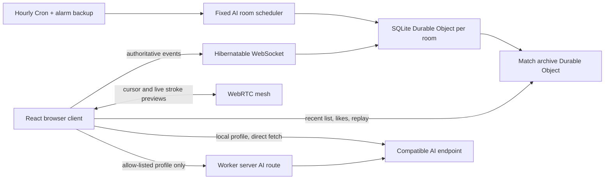

# Architecture

## Overview

DrawGuessAI is a pnpm workspace with two deployable applications and five platform-neutral packages.

| Workspace                   | Responsibility                                                               |
| --------------------------- | ---------------------------------------------------------------------------- |
| `apps/web`                  | React UI, Canvas input/rendering, Dedicated Worker AI execution, WebRTC mesh |
| `apps/worker`               | Hono routes, static assets, signaling, TURN credentials, room Durable Object |
| `packages/game-core`        | XState phases, seeded schedules, events, reducers, replay hashes             |
| `packages/canvas-protocol`  | Quantized commands, limits, validation, rendering semantics                  |
| `packages/network-protocol` | Versioned envelopes, messages, visibility and idempotency                    |
| `packages/ai-adapters`      | OpenAI/Anthropic-compatible fetch adapters and twelve personas               |
| `packages/word-bank`        | 555 curated records across 15 categories with locale-aware selection rules   |

## Authority and previews

The Durable Object is authoritative. It validates every drawing draft, final drawing, guess, reaction, permission, sequence, and replay transition. WebRTC DataChannels only carry disposable cursor and completed live-mark previews. A peer that cannot receive a DataChannel preview gets the same preview over WebSocket; private draft snapshots and final commands always travel over WebSocket and are revalidated.

Blind-relay preview recipients are explicitly filtered. A player who has not acted receives progress only. Spectators, the active player, and players who already acted may receive previews. A local AI executor can still inspect its own background requests through developer tools; this is an explicitly documented experience-level limitation rather than an anti-cheat promise.

## Determinism

Room schedules and prompt selection use saved seeds. Domain transitions are append-only `GameEvent` records in SQLite and reduce through `applyGameEvent`. Event IDs make repeated delivery idempotent, while monotonic sequence numbers provide ordering and audit context. The ordered WebSocket and visibility-filtered snapshots reconcile connection and transition boundaries. Replay JSON includes protocol version `1`, the materialized state, and the ordered event list.

Every curated prompt declares its semantic kind. New prompts are limited to dictionary-style words, compact noun or activity phrases, idioms, proverbs, and Chinese xiehouyu. Chinese games additionally allow 35 familiar complete classical poem lines; English selection excludes that category and the custom prompt UI hides it. Improvised subject-predicate descriptions remain invalid. The shared locale-aware validator applies the same rule to custom and AI-generated prompts before the Durable Object accepts them.

Every AI timeline position has its own actor ID, persona, name, and avatar. The same underlying model profile or base persona may execute several actors, but schedules never reuse one AI actor within a relay. Each built-in persona carries an explicit drawing character plus separate live-reaction and roundtable voices, so identity affects composition, geometry, brushes, palette, conversational focus, and cadence without weakening recognizability. Hosts can layer a custom display name, description, drawing/turn prompt, and roundtable prompt over any base persona while keeping its avatar, so a chain of up to twelve turns remains visibly composed of distinct players.

## Room lifecycle

1. A create request generates an eight-character room code and independent 192-bit reconnect and host credentials.
2. One SQLite Durable Object owns that room code.
3. The room progresses through `lobby -> prompt -> turn -> inspect -> reaction -> reveal -> complete`; an unrecoverable AI drawing fault moves `turn` or `inspect` to terminal `failed`.
4. Durable Object alarms submit the last validated visible human or AI drawing draft on timeout, stop an AI drawing only when no valid draft exists, submit bounded guess fallbacks, and advance reaction beats.
5. Completion creates an unguessable replay token and first writes a self-contained archive envelope to a room-local SQLite outbox. Delivery to the match archive is idempotent by replay token and retries with bounded exponential backoff, so a rematch cannot overwrite a replay that is waiting for delivery. Unliked records follow the room replay retention setting. Three independent anonymous voters are required for the bounded long-term retention pool. Archive listing uses a `(completed_at, token)` cursor and bounded pages.
6. Hosts can reset a completed or failed relay in place. The room keeps its participants, host ownership, configuration, and timeline while clearing per-game artifacts, reactions, reviews, and transient AI work.

Lobby departures are authoritative events: the member and reconnect credential are removed, the blind timeline is rebuilt, and an abandoning host transfers ownership to a connected successor or closes an empty room. A disconnected human still scheduled when the host starts is removed and replaced through the deterministic AI-filled timeline instead of producing a ghost turn.

## Automated room

`MACH8888` is a fixed spectator-only AI room. Its default game uses the Chinese curated prompt bank, an eight-turn AI-theatre relay with eight distinct AI seats, spectators enabled, no AI observation passes, and ten seconds of AI drawing playback. The seats receive distinct randomized display names from the same pool as ordinary rooms; a persisted identity seed keeps those names stable across hourly rematches, while an upgrade replaces legacy numbered labels at the next safe lobby boundary. After the relay, the same AI seats publish the post-game roundtable before the match is archived. An hourly Worker Cron trigger wakes a dedicated scheduler Durable Object; its alarm is a second wake-up path, and the scheduler deduplicates both deliveries within an hour. Failed runs retry every two minutes, up to three attempts in the current hour, before moving to the next hour boundary. The public status endpoint reads scheduler state only: it cannot initialize a room, write storage, or schedule an alarm. The room selects a deployment-owned multimodal model, allows up to two minutes for a drawing request and thirty seconds for a guess. A drawing provider attempt is capped at one minute and a guess attempt at fifteen seconds, so a stalled provider call can retry inside the authoritative turn deadline. It never replaces a failed model response with a simulated drawing. Player joins are rejected server-side in every phase, legacy non-spectator members are removed, and disconnected spectators are pruned after a short reconnect grace period.

## AI execution

Browser profiles use a Dedicated Worker and contact the configured endpoint directly. Server profiles are deployment-owned, allow-listed records parsed from a Worker secret. The room issues an idempotent `AiTurnJob`; only the current executor may submit its matching result. Drawing and guessing deadlines cap the complete AI pipeline, including repair and inspection passes. Profiles use fast inline composition by default and may opt into a slower separate scene-plan request. Public-safe `ai.activity` updates expose execution stages, including active retries, without raw prompts or private model reasoning. Invalid non-drawing output receives one repair request. Drawing commands are validated independently, so malformed local commands are skipped while surviving marks render; bounded private error markers guide the next observation pass and are stripped before submission. An initial drawing with no surviving visible content receives up to four provider attempts. A parsed drawing that exceeds combined canvas limits receives validation feedback and up to four corrected candidate attempts per pass. If no visible valid stroke survives, the authoritative room enters `failed` instead of advancing a blank turn. Accepted commands are then previewed action by action over WebRTC or WebSocket before the authoritative result is submitted. Local worker, protocol, timeout, provider HTTP, and server-route failures retain separate public-safe error codes; unexpected client exceptions are reported immediately instead of leaving the room waiting for the full turn deadline.
